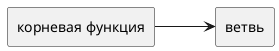

# Концепция и границы. <название кейса>

Вариант:  
Команда:  
Дата:

Схемы — исходники PlantUML в каталоге `diagrams`. Картинка без `.puml` не заменяет исходник.

## 1. Введение

Какую работу люди делают сейчас и что должно измениться в первом выпуске.

## 2. Бизнес-контекст и цели

### Исходные данные

Как процесс идёт сейчас. Если есть модель AS-IS, ссылка на `diagrams/asis.puml`.

### Возможность

### Бизнес-цели

| ID | Цель | Как измеряем | Сейчас | План |
|----|------|--------------|--------|------|
| BG-1 | | | | |

### Критерии успеха

1.

### Видение

### Риски, предположения и зависимости

Кратко. Реестр рисков — в разделе 8, допущения — в разделе 7.

## 3. Стейкхолдеры

| Роль | Интерес | Влияние | Отношение |
|------|---------|---------|-----------|
| | | | |

## 4. Функции

Дерево функций. Исходник: `diagrams/function-tree.puml`.

Контекст решения: `diagrams/context.puml`.

### Сценарий UC-1. <цель актора>

- Актор:
- Предусловие:
- Триггер:
- Основной поток:
- Альтернатива:
- Исключение:
- Постусловие успеха:

Остальные сценарии — таблицей, если подробно они раскрываются в лабораторной 2.

| ID | Кратко |
|----|--------|
| UC-2 | |

## 5. Нефункциональные ограничения первого взгляда

Что нельзя отложить даже до отдельной спецификации: доступ к данным, подпись, журнал, смежные системы.

## 6. Границы

### В рамках первого выпуска

### Вне рамок

### Выпуски

| Выпуск | Состав |
|--------|--------|
| 1 | |

## 7. Ограничения и допущения

- Допущение:
- Ограничение:
- Зависимость:

## 8. Риски

| ID | Риск | Вероятность | Ущерб | Что делаем |
|----|------|-------------|--------|------------|
| R-1 | | | | |

## 9. Критерии приёмки концепции

1.
