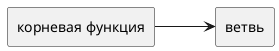

# Концепция и границы. <название кейса>

Вариант:  
Команда:  
Дата:

Схемы — исходники PlantUML в каталоге `diagrams`. Картинка без `.puml` не заменяет исходник.

## 1. Введение

Какую работу люди делают сейчас и что должно измениться в первом выпуске.

## 2. Бизнес-контекст и цели

### Исходные данные

Как процесс идёт сейчас. Если есть модель AS-IS, ссылка на `diagrams/asis.puml`.

### Возможность

### Бизнес-цели

| ID | Цель | Как измеряем | Сейчас | План |
|----|------|--------------|--------|------|
| BG-1 | | | | |

### Критерии успеха

1.

### Видение

### Риски, предположения и зависимости

Кратко. Реестр рисков — в разделе 8, допущения — в разделе 7.

## 3. Стейкхолдеры

| Роль | Интерес | Влияние | Отношение |
|------|---------|---------|-----------|
| Учебное управление| Быстро собирать расписание на семестр, видеть загруженность преподавателей и аудиторий, контролировать актуальность расписания| Высокое: заказчик определяет требования и принимает результат работы| За, если расписание составляется быстрее и не требует повторного ввода уже имеющихся справочников|
|Диспетчер расписания|Составлять и корректировать расписание в одном месте, разрешать конфликты и обрабатывать исключения без ручного сведения множества таблиц|Высокое: основной пользователь, от его действий зависит корректность итогового расписания|За, если система упрощает повседневную работу и автоматически использует имеющиеся данные|
|Преподаватель|Получать актуальное расписание, своевременно узнавать о переносах, отменах занятий, смене аудитории или преподавателя|Среднее: использует опубликованное расписание, но не управляет процессом его составления|За, если расписание доступно в MAX и уведомления приходят вовремя|
|Студент|Быстро узнавать расписание своих занятий и получать информацию об изменениях без поиска файлов на портале или ожидания рассылки|Среднее: является одним из основных получателей результата, но не участвует в составлении расписания|За, если расписание в MAX актуально и понятно|
|ИТ-отдел университета|Обеспечить доступ к существующим данным об организационной структуре, аудиториях, преподавателях, учебных группах, учебных планах и нагрузке|Высокое: от доступности и корректности исходных данных зависит возможность автоматического формирования расписания|За, если приложение использует действующие информационные системы и не создаёт параллельные справочники|
|Кафедры и руководители подразделений|Согласовывать расписание и решать вопросы распределения учебной нагрузки, преподавателей и аудиторий|Среднее: могут участвовать в согласовании исключений и разрешении спорных ситуаций|Осторожное: заинтересованы в корректном распределении занятий, но могут опасаться дополнительных согласований и усложнения процесса|
|Администратор или ответственный за интеграцию с MAX|Обеспечить передачу актуального расписания в MAX и корректное отображение информации для студентов и преподавателей|Высокое: без работающей интеграции один из основных результатов проекта не будет достигнут|За, если обмен данными работает стабильно и не требует постоянной ручной публикации|
## 4. Функции

Дерево функций. Исходник: `diagrams/function-tree.puml`.

Контекст решения: `diagrams/context.puml`.

### Сценарий UC-1. <цель актора>

- Актор:
- Предусловие:
- Триггер:
- Основной поток:
- Альтернатива:
- Исключение:
- Постусловие успеха:

Остальные сценарии — таблицей, если подробно они раскрываются в лабораторной 2.

| ID | Кратко |
|----|--------|
| UC-2 | |

## 5. Нефункциональные ограничения первого взгляда

Что нельзя отложить даже до отдельной спецификации: доступ к данным, подпись, журнал, смежные системы.

## 6. Границы

### В рамках первого выпуска

### Вне рамок

### Выпуски

| Выпуск | Состав |
|--------|--------|
| 1 | |

## 7. Ограничения и допущения

- Допущение:
- Ограничение:
- Зависимость:

## 8. Риски

| ID | Риск | Вероятность | Ущерб | Что делаем |
|----|------|-------------|--------|------------|
|R-1|Данные в корпоративных системах неполные или неактуальные: отсутствуют сведения о преподавателях, аудиториях, группах или учебной нагрузке|Средняя|Высокий: расписание будет содержать ошибки или его не удастся сформировать автоматически| До формирования расписания проверять полноту исходных данных. Ошибки и отсутствующие сведения направлять ответственным за соответствующие системы, не создавая параллельные справочники|
|R-2|При составлении расписания возникают конфликты: преподаватель, группа или аудитория назначены на несколько занятий одновременно|Высокая|Высокий: расписание становится некорректным, требуется ручная переработка|Проверять пересечения занятий при размещении и изменении пар. Не позволять подтверждать публикацию расписания с неразрешёнными критическими конфликтами|
|R-3|Диспетчер продолжает собирать расписание вручную в таблицах и повторно вводить данные, несмотря на внедрение приложения|Средняя|Высокий: ожидаемое сокращение трудозатрат не достигается|Организовать формирование расписания на основе существующих данных, сократить число ручных операций и проверить на практике, что основной сценарий выполняется в приложении|
|R-4|Расписание не публикуется в MAX или изменения передаются с задержкой|Средняя|Высокий: преподаватели и студенты получают устаревшую информацию|Проверять успешность передачи и отображения расписания, предусмотреть обработку ошибок интеграции и повторную отправку изменений|
|R-5|После публикации расписание изменяется, но пользователи не получают уведомления об изменениях|Средняя|Высокий: студенты и преподаватели могут прийти не в ту аудиторию или пропустить перенесённое занятие|Отслеживать изменения опубликованного расписания и проверять отправку уведомлений о переносе или отмене занятия, смене аудитории и преподавателя|
|R-6|Приложение пытаются расширить задачами, не относящимися к составлению расписания, например полноценным управлением учебными планами или кадровым учётом|Средняя|Средний: увеличиваются сроки разработки, а основные задачи откладываются|Зафиксировать границы первого выпуска: получение исходных данных, составление расписания, анализ загрузки и публикация в MAX. Изменения объёма согласовывать с учебным управлением|
## 9. Критерии приёмки концепции
Учебное управление принимает концепцию, если одновременно выполняются следующие условия:

1. Приложение использует существующие данные университета об организационной структуре, аудиториях, преподавателях, учебных группах, учебных планах и учебной нагрузке без повторного ручного ввода справочников.

2. Диспетчер может сформировать расписание занятий на семестр в едином приложении, используя имеющиеся данные, и при необходимости вручную размещать занятия, корректировать исключения и разрешать конфликты.

3. Система позволяет выявлять пересечения занятий и конфликты использования ресурсов: одновременное назначение преподавателя, учебной группы или аудитории на несколько занятий.

4. Учебное управление может просматривать отчёты о загруженности преподавателей и аудиторий на основании сформированного расписания и использовать эти сведения для принятия решений.

5. Актуальное расписание можно опубликовать в MAX, чтобы студенты и преподаватели получали информацию о своих занятиях без необходимости искать файлы на портале или ждать рассылки по электронной почте.

6. При изменении опубликованного расписания предусмотрена передача актуальной информации пользователям, включая уведомления о переносе или отмене занятия, смене аудитории и замене преподавателя
