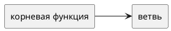

# Концепция и границы. <название кейса>

Вариант:  
Команда:  
Дата:

Схемы — исходники PlantUML в каталоге `diagrams`. Картинка без `.puml` не заменяет исходник.

## 1. Введение

Учебное управление университета составляет расписание занятий на семестр, используя сведения о кафедрах, аудиториях, преподавателях, учебных группах, учебных планах и нагрузке по дисциплинам. Сейчас значительная часть работы выполняется вручную: данные повторно вводятся в таблицы, расписание сводится из разных источников, а оценка загруженности преподавателей и аудиторий требует дополнительных действий. Это увеличивает время подготовки расписания и приводит к ошибкам, которые могут обнаруживаться уже в первую учебную неделю.

Решение должно использовать сведения, уже хранящиеся в корпоративных информационных системах университета, без повторного ручного заполнения справочников. Диспетчер учебного управления формирует расписание, разрешает возникающие конфликты и обрабатывает исключения. Система позволяет просматривать загруженность преподавателей и аудиторий, выявлять перегрузки и простой ресурсов, а также передавать актуальное расписание студентам и преподавателям через мессенджер MAX.

В первом выпуске необходимо сосредоточиться на формировании расписания из существующих данных, анализе загрузки преподавателей и аудиторий и публикации расписания в MAX. Основная цель — сократить объём ручного труда и ускорить подготовку расписания, сохранив принятие необходимых организационных решений за ответственными сотрудниками учебного управления.

## 2. Бизнес-контекст и цели

### Исходные данные

Как процесс идёт сейчас. Если есть модель AS-IS, ссылка на `diagrams/asis.puml`.

### Возможность

### Бизнес-цели

| ID | Цель | Как измеряем | Сейчас | План |
|----|------|--------------|--------|------|
| BG-1 | | | | |

### Критерии успеха

1.

### Видение

### Риски, предположения и зависимости

Кратко. Реестр рисков — в разделе 8, допущения — в разделе 7.

## 3. Стейкхолдеры

| Роль | Интерес | Влияние | Отношение |
|------|---------|---------|-----------|
| | | | |

## 4. Функции

Дерево функций. Исходник: `diagrams/function-tree.puml`.

Контекст решения: `diagrams/context.puml`.

### Сценарий UC-1. <цель актора>

- Актор:
- Предусловие:
- Триггер:
- Основной поток:
- Альтернатива:
- Исключение:
- Постусловие успеха:

Остальные сценарии — таблицей, если подробно они раскрываются в лабораторной 2.

| ID | Кратко |
|----|--------|
| UC-2 | |

## 5. Нефункциональные ограничения первого взгляда

Что нельзя отложить даже до отдельной спецификации: доступ к данным, подпись, журнал, смежные системы.

## 6. Границы

### В рамках первого выпуска

- Получение и использование существующих данных об университете: структуре подразделений, аудиториях, преподавателях, учебных группах, учебных планах, дисциплинах и учебной нагрузке.
- Формирование и редактирование расписания занятий ответственным сотрудником учебного управления на основе полученных данных.
- Указание времени, периода проведения, дисциплины, типа занятия, преподавателя, группы, корпуса и аудитории.
- Просмотр загруженности преподавателей и аудиторий для выявления перегрузок и свободных ресурсов.
- Подготовка актуального расписания к передаче в сервис «Расписание занятий» в MAX с использованием согласованного формата и способа интеграции.
- Передача актуального расписания в MAX и проверка корректности его отображения для студентов и преподавателей в рамках согласованного механизма интеграции.

### Вне рамок

- Создание и ведение справочников университета вместо использования данных из существующих информационных систем.
- Изменение кадровых данных, учебных планов и других исходных сведений в корпоративных системах.
- Разработка системы учёта успеваемости и результатов аттестации студентов.
- Полностью автоматическое составление расписания без участия диспетчера в принятии организационных решений.

### Выпуски

| Выпуск | Состав |
|--------|--------|
| 1 | Использование существующих данных университета, формирование и редактирование расписания, анализ загруженности преподавателей и аудиторий, подготовка расписания к публикации и передача в MAX в рамках согласованного механизма интеграции. |

## 7. Ограничения и допущения

- Допущение:
- Ограничение:
- Зависимость:

## 8. Риски

| ID | Риск | Вероятность | Ущерб | Что делаем |
|----|------|-------------|--------|------------|
| R-1 | | | | |

## 9. Критерии приёмки концепции

1.
