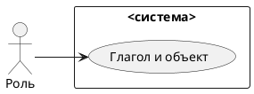
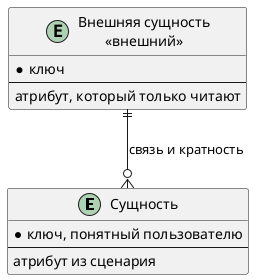

# Документ пользовательских требований

Вариант:  
Команда:  
Связанный документ концепции: `case_concept.md` (лабораторная работа 1)  
Дата:

Пользовательское требование фиксируется на уровне эпика. Каждый эпик оформлен и пользовательской историей, и сценарием использования.

## 1. Реинжиниринг дерева функций

Исходное дерево функций взято из документа концепции без переписывания «как хотелось бы».

```text
Сформировать расписание занятий
├── Получить данные из корпоративных систем
│   ├── Загрузить данные о преподавателях, группах, аудиториях, нагрузке
│   └── Проверить полноту исходных данных
├── Сформировать и редактировать расписание
│   ├── Разместить занятие (дисциплина, тип, время, группа, аудитория, преподаватель)
│   ├── Проверить конфликты (преподаватель / группа / аудитория)
│   ├── Разрешить конфликт вручную
│   ├── Утвердить расписание
│   └── Изменить опубликованное расписание (перенос, отмена, замена)
├── Анализировать загруженность ресурсов
│   ├── Просмотреть загрузку преподавателей
│   └── Просмотреть загрузку аудиторий
└── Опубликовать расписание в MAX
    ├── Подготовить данные в формате MAX
    ├── Передать расписание в MAX
    ├── Уведомить об изменениях
    └── Вести журнал изменений
```

| ID | Пользовательское требование | Узел дерева | Есть в дереве | Что сделано |
|----|-----------------------------|-------------|---------------|-------------|
| EP-1 | Диспетчер получает данные из корпоративных систем и видит, чего не хватает | Получить данные из корпоративных систем | да | оставлен |
| EP-2 | Программа автоматически составляет расписание, диспетчер запускает процесс | Разместить занятие → Автоматически составить расписание | да (переработан) | узел переименован: ручное размещение заменено автосоставлением. Конфликты, найденные алгоритмом, передаются в EP-3 |
| EP-3 | Диспетчер видит конфликты и разрешает их вручную | Проверить конфликты, Разрешить конфликт вручную | да | два узла объединены в один эпик: цель пользователя одна, снять конфликт |
| EP-4 | Диспетчер утверждает и публикует расписание | Утвердить расписание, Передать расписание в MAX | да | оставлен. Публикация затрагивает и веб-версию, см. EP-5 |
| EP-5 | Студент и преподаватель смотрят расписание в MAX и в веб-версии | нет | **нет** | добавлен узел «Показать расписание пользователю» с листьями «в MAX» и «в веб-версии». В концепции сам просмотр был только сценарием UC-1, а не функцией |
| EP-6 | Диспетчер вносит изменение в опубликованное расписание | Изменить опубликованное расписание | да | оставлен |
| EP-7 | Студент и преподаватель получают уведомление об изменении | Уведомить об изменениях | да | оставлен, вынесен отдельным эпиком: ценность у получателя, а не у диспетчера |
| EP-8 | Учебное управление видит журнал изменений | Вести журнал изменений | да | вынесен отдельным эпиком: журнал нужен учебному управлению, а не только как шаг изменения |
| EP-9 | Учебное управление видит загруженность преподавателей и аудиторий | Просмотреть загрузку преподавателей, Просмотреть загрузку аудиторий | да | два листа объединены: один отчёт с двумя срезами |

Не вошло в эпики, и почему:

| Что | Почему не вошло |
|-----|-----------------|
| Архив расписаний прошлых семестров (есть у аналога) | нет в концепции и в границах первого выпуска. Приоритет Could, кандидат на следующий выпуск |
| Отдельный функционал согласования кафедрами | в дереве нет, в границах не заявлен. Согласование идёт вне приложения, диспетчер утверждает версию |
| Автоматическое составление | включено в EP-2: является ядром функционала |
| Правка справочников | в концепции вне рамок, приложение только читает |

Скорректированное дерево:

```text
Сформировать расписание занятий
├── Получить данные из корпоративных систем
├── Сформировать и редактировать расписание
│   ├── Автоматически составить расписание 
│   ├── Разрешить конфликт вручную
│   ├── Утвердить расписание
│   └── Изменить опубликованное расписание
├── Анализировать загруженность ресурсов
├── Опубликовать расписание
│   ├── Подготовить данные в формате MAX
│   ├── Передать расписание в MAX
│   ├── Уведомить об изменениях
│   └── Вести журнал изменений
└── Показать расписание пользователю          ← новый узел
    ├── В MAX
    └── В веб-версии
```

## 2. Диаграмма вариантов использования

Исходник: `diagrams/usecase.puml`. Картинка без этого файла не принимается.



Граница системы:

| Узел дерева | Вариант использования | Актор |
|-------------|----------------------|-------|
| Загрузить данные, проверить полноту | UC-7 Загрузить данные и проверить полноту | Диспетчер, корпоративные системы |
| Автоматически составить расписание | UC-3 Запустить автосоставление расписания | Диспетчер (запускает), Приложение (выполняет) |
| Проверить конфликты, разрешить вручную | UC-2 Разрешить конфликт вручную | Диспетчер |
| Утвердить, передать в MAX | UC-4 Подтвердить публикацию | Диспетчер, MAX |
| Показать расписание пользователю | UC-1 Получить актуальное расписание | Студент, преподаватель |
| Изменить опубликованное расписание | UC-5 Изменить опубликованное расписание | Диспетчер |
| Уведомить об изменениях | UC-9 Уведомить об изменении | include из UC-5; получатели студент и преподаватель, канал MAX |
| Вести журнал изменений | UC-8 Записать изменение в журнал | include из UC-5 |
| Просмотреть загрузку | UC-6 Просмотреть загруженность | Учебное управление, диспетчер |


UC-8 и UC-9 не запускают сами по себе: они включаются в успешное изменение опубликованного расписания.

## 3. Эпики

### EP-1. Получить данные и проверить их полноту

- Уровень: эпик
- Узел дерева: получить данные из корпоративных систем
- Бизнес-цель: BG-1
- Источник: диспетчер расписания
- Приоритет: Must

**Пользовательская история.** Как диспетчер расписания, я хочу, чтобы приложение само загрузило преподавателей, группы, аудитории, учебные планы и нагрузку и показало, каких данных не хватает, чтобы не вводить справочники вручную и не размещать занятия на неполных данных.

**Сценарий UC-7.**

| Поле | Содержание |
|------|------------|
| Акторы | Диспетчер. Приложение. Корпоративные системы |
| Предусловия | Диспетчер вошёл в приложение. Корпоративные системы доступны |
| Триггер | Диспетчер запускает загрузку данных на семестр |
| Постусловие успеха | Данные загружены, диспетчер видит результат проверки полноты, размещение занятий доступно |
| Постусловие отказа | Размещение занятий недоступно, справочники не изменены |

Основной поток:

1. Диспетчер выбирает семестр и запускает загрузку.
2. Приложение запрашивает данные у корпоративных систем.
3. Приложение получает данные и проверяет полноту: у каждой единицы нагрузки есть дисциплина, тип занятия, группа и преподаватель.
4. Приложение показывает, что данные полные.
5. Размещение занятий становится доступно.

Альтернативы:

1. Часть данных отсутствует. Приложение показывает перечень пропусков и систему, которая за них отвечает. Занятия по неполной нагрузке разместить нельзя, остальные можно. Пропуски диспетчер передаёт ответственным вне приложения, справочник в приложении не заводится.

Исключения:

1. Корпоративная система недоступна. Приложение сообщает об этом и не использует устаревшие данные, размещение занятий недоступно.

### EP-2. Автоматически составить расписание

- Уровень: эпик
- Узел дерева: автоматически составить расписание
- Бизнес-цель: BG-1
- Источник: диспетчер расписания
- Приоритет: Must

**Пользовательская история.** Как диспетчер расписания, я хочу запустить автоматическое составление расписания на семестр, чтобы получить начальный вариант без ручного ввода каждого занятия и сосредоточиться только на разрешении найденных конфликтов.

**Сценарий UC-3.**

| Поле | Содержание |
|------|------------|
| Акторы | Диспетчер. Приложение |
| Предусловия | Данные загружены, нагрузка полная (EP-1 выполнен) |
| Триггер | Диспетчер запускает автосоставление расписания на семестр |
| Постусловие успеха | Все единицы нагрузки размещены в сетке; конфликты, которые алгоритм не смог разрешить, выделены для ручного разрешения (EP-3); загруженность преподавателей и аудиторий обновлена |
| Постусловие отказа | Расписание не сформировано, данные не изменены |

Основной поток:

1. Диспетчер выбирает семестр и запускает автосоставление.
2. Приложение перебирает все единицы нагрузки и распределяет их по доступным слотам и аудиториям согласно правилам учебного управления.
3. Приложение проверяет пересечения: преподаватель, группа, аудитория.
4. Пересечений нет, все занятия размещены.
5. Приложение показывает результат: количество размещённых занятий, загруженность, статус готовности к публикации.

Альтернативы:

1. Часть занятий размещена с конфликтами. Занятия со статусом «с конфликтом» помещаются в список неразрешённых конфликтов. Диспетчер переходит к EP-3. Публикация заблокирована, пока конфликты не сняты.
2. Часть нагрузки не удалось разместить (нет подходящего свободного слота или аудитории). Приложение показывает перечень неразмещённых единиц нагрузки с причиной. Диспетчер разрешает вручную через EP-3.

Исключения:

1. Выбранный семестр уже имеет черновик расписания. Приложение предупреждает и предлагает: перезапустить (черновик будет заменён) или отменить.
2. Нет допустимых слотов для размещения (слоты не сконфигурированы). Автосоставление не запускается, диспетчер получает сообщение об ошибке конфигурации.

### EP-3. Увидеть конфликты и разрешить их вручную

- Уровень: эпик
- Узел дерева: проверить конфликты, разрешить конфликт вручную
- Бизнес-цель: BG-1
- Источник: диспетчер расписания
- Приоритет: Must

**Пользовательская история.** Как диспетчер, я хочу видеть, какие занятия пересекаются после автосоставления, и вручную менять время, аудиторию или преподавателя, чтобы устранить все конфликты и расписание можно было утвердить без ошибок, которые иначе всплывут в первую неделю.

**Сценарий UC-2.**

| Поле | Содержание |
|------|------------|
| Акторы | Диспетчер. Приложение |
| Предусловия | В расписании есть неразрешённый конфликт, выявленный автосоставлением (EP-2) или при изменении опубликованного расписания (EP-6) |
| Триггер | Диспетчер открывает список конфликтов после завершения автосоставления или после попытки изменить расписание |
| Постусловие успеха | Конфликт снят, занятие зафиксировано без пересечения |
| Постусловие отказа | Конфликт остаётся в списке, публикация заблокирована |

Основной поток:

1. Приложение показывает неразрешённые конфликты: вид (преподаватель, группа, аудитория), занятия и время пересечения.
2. Диспетчер выбирает конфликт.
3. Диспетчер меняет время, аудиторию или преподавателя одного из занятий.
4. Приложение перепроверяет пересечения.
5. Конфликт снят, занятие фиксируется, загруженность обновляется.

Альтернативы:

1. Правка создала новый конфликт. Новый конфликт попадает в список, прежний считается снятым только после перепроверки.

Исключения:

1. Новый преподаватель или аудитория недоступны в данных (система недоступна). Правка не принимается, расписание не строится на устаревших данных.

### EP-4. Утвердить и опубликовать расписание

- Уровень: эпик
- Узел дерева: утвердить расписание, передать расписание в MAX
- Бизнес-цель: BG-3
- Источник: диспетчер расписания, учебное управление
- Приоритет: Must

**Пользовательская история.** Как диспетчер, я хочу утвердить расписание без конфликтов и опубликовать его, чтобы студенты и преподаватели видели ровно ту версию, которую я утвердил, и в MAX, и в веб-версии.

**Сценарий UC-4.**

| Поле | Содержание |
|------|------------|
| Акторы | Диспетчер. Приложение. MAX |
| Предусловия | Расписание размещено, неразрешённых конфликтов нет |
| Триггер | Диспетчер подтверждает публикацию |
| Постусловие успеха | Версия утверждена, принята MAX и доступна в веб-версии |
| Постусловие отказа | Версия не опубликована ни в одном канале, пользователи видят прежнюю опубликованную версию |

Основной поток:

1. Диспетчер запрашивает публикацию.
2. Приложение проверяет, что конфликтов нет.
3. Приложение утверждает версию.
4. Приложение готовит данные в формате MAX и передаёт их.
5. MAX подтверждает приём.
6. Версия становится опубликованной, веб-версия показывает её же.
7. Диспетчер видит статус «опубликовано».

Альтернативы:

1. Остались конфликты. Публикация блокируется, приложение показывает список конфликтов. Поток переходит в UC-2.

Исключения:

1. Передача в MAX не удалась. Версия не считается опубликованной ни в MAX, ни в веб-версии, диспетчер получает уведомление об ошибке и может повторить отправку.

### EP-5. Посмотреть актуальное расписание в MAX или в веб-версии

- Уровень: эпик
- Узел дерева: показать расписание пользователю (новый)
- Бизнес-цель: BG-3
- Источник: студент, преподаватель
- Приоритет: Must

**Пользовательская история.** Как студент или преподаватель, я хочу открыть актуальное расписание своей группы или своё в MAX либо в обычной веб-версии, чтобы знать, где и когда занятия, не ища файлы на портале.

**Сценарий UC-1.**

| Поле | Содержание |
|------|------------|
| Акторы | Студент или преподаватель. MAX. Веб-версия |
| Предусловия | Есть опубликованная версия. Для MAX: аккаунт сопоставлен с группой или преподавателем |
| Триггер | Пользователь открывает расписание |
| Постусловие успеха | Пользователь видит занятия последней опубликованной версии: дисциплину, тип, время, преподавателя или группу, корпус, аудиторию |
| Постусловие отказа | Пользователь не видит неопубликованных данных |

Основной поток, MAX:

1. Пользователь открывает «Расписание занятий» в MAX.
2. Приложение определяет по аккаунту группу или преподавателя.
3. Пользователь видит занятия на день.
4. Пользователь переключает вид «день» или «неделя» и листает период.

Основной поток, веб-версия:

1. Пользователь открывает страницу расписания.
2. Выбирает «студент» или «преподаватель» и находит свою группу или себя в списке с поиском.
3. Выбирает вид «день» или «неделя» и период.
4. Видит занятия.

Альтернативы:

1. Расписание изменено после публикации. Пользователь видит обновлённую версию, изменённое занятие помечено.
2. В веб-версии поиск ничего не нашёл. Показывается сообщение «Группы не найдены» или «Преподаватели не найдены» с просьбой уточнить поиск.
3. Группа или преподаватель не выбраны. Веб-версия показывает подсказку выбрать из списка.

Исключения:

1. Опубликованной версии нет. Пользователь видит сообщение, что расписание ещё не опубликовано.
2. Аккаунт MAX не сопоставлен. Личное расписание не показывается, чужое не показывается.
3. Передача свежего изменения в MAX не удалась. Пользователь продолжает видеть последнюю успешно опубликованную версию.

Допущение: веб-версия открыта без входа, как у аналога; пользователь выбирает группу или преподавателя сам. Подтвердить с заказчиком, см. 5.8.

### EP-6. Изменить опубликованное расписание

- Уровень: эпик
- Узел дерева: изменить опубликованное расписание
- Бизнес-цель: BG-3
- Источник: диспетчер расписания
- Приоритет: Must

**Пользовательская история.** Как диспетчер, я хочу перенести или отменить занятие, сменить аудиторию или заменить преподавателя в опубликованном расписании, чтобы расписание соответствовало реальности, а пользователи об этом узнали.

**Сценарий UC-5.**

| Поле | Содержание |
|------|------------|
| Акторы | Диспетчер. Приложение. MAX |
| Предусловия | Есть опубликованная версия |
| Триггер | Диспетчер вносит исключение: перенос, отмена, смена аудитории, замена преподавателя |
| Постусловие успеха | Изменение опубликовано, в журнале есть запись, затронутые пользователи уведомлены |
| Постусловие отказа | Изменение не опубликовано, пользователи видят прежнее занятие |

Основной поток:

1. Диспетчер выбирает занятие в опубликованной версии.
2. Диспетчер вносит изменение.
3. Приложение проверяет пересечения, их нет.
4. Приложение передаёт изменение в MAX и обновляет веб-версию.
5. Изменение опубликовано.
6. Приложение пишет журнал: это включение UC-8.
7. Приложение уведомляет пользователей: это включение UC-9.

Альтернативы:

1. Изменение создаёт конфликт. Оно не публикуется, пользователи видят прежнее занятие, диспетчер разрешает конфликт по UC-2.

Исключения:

1. Передача в MAX не удалась. Изменение не считается опубликованным, журнал и уведомления не пишутся и не отправляются, диспетчер получает уведомление об ошибке и может повторить.

### EP-7. Узнать об изменении расписания

- Уровень: эпик
- Узел дерева: уведомить об изменениях
- Бизнес-цель: BG-3
- Источник: студент, преподаватель
- Приоритет: Must

**Пользовательская история.** Как студент или преподаватель, я хочу получить уведомление в MAX о переносе, отмене, смене аудитории или замене преподавателя, чтобы не прийти не в ту аудиторию и не пропустить перенесённое занятие.

**Сценарий UC-9.**

| Поле | Содержание |
|------|------------|
| Акторы | Приложение. MAX. Студент, преподаватель |
| Предусловия | Изменение опубликовано. Аккаунт получателя сопоставлен |
| Триггер | Успешная публикация изменения (UC-5) |
| Постусловие успеха | Каждый затронутый получатель получил уведомление в MAX |
| Постусловие отказа | Изменение остаётся опубликованным и видно в расписании, диспетчер видит ошибку отправки |

Основной поток:

1. Приложение определяет получателей: студентов затронутой группы и преподавателей занятия.
2. Приложение отправляет уведомление: что изменилось, было и стало.
3. Получатель видит уведомление в MAX и открывает обновлённое занятие.

Альтернативы:

1. Замена преподавателя. Уведомление получают оба: прежний и новый преподаватель, а также студенты группы.
2. Пользователь работает в веб-версии. Уведомления нет, изменённое занятие помечено в расписании (EP-5). Push из веб-версии вне выпуска.

Исключения:

1. Отправка уведомления не удалась. Диспетчер видит, кому не доставлено, и может повторить отправку.

### EP-8. Вести журнал изменений

- Уровень: эпик
- Узел дерева: вести журнал изменений
- Бизнес-цель: BG-3
- Источник: учебное управление
- Приоритет: Must

**Пользовательская история.** Как сотрудник учебного управления, я хочу, чтобы каждое опубликованное изменение оставляло запись, чтобы можно было выяснить, что, когда и кем менялось.

**Сценарий UC-8.**

| Поле | Содержание |
|------|------------|
| Акторы | Приложение. Читают: диспетчер, учебное управление |
| Предусловия | Изменение опубликовано |
| Триггер | Успешное завершение UC-5 |
| Постусловие успеха | В журнале есть запись об этом изменении |
| Постусловие отказа | Изменения нет, значит и записи нет |

Основной поток:

1. Приложение фиксирует занятие, вид изменения, было и стало, время и автора.
2. Запись доступна сотруднику учебного управления для просмотра.

Альтернативы:

1. Нет отдельной альтернативы «изменить без журнала».

Исключения:

1. Запись не сохранилась. Изменение не считается завершённым, диспетчер видит ошибку и повторяет запись.

### EP-9. Просмотреть загруженность преподавателей и аудиторий

- Уровень: эпик
- Узел дерева: просмотреть загрузку преподавателей, просмотреть загрузку аудиторий
- Бизнес-цель: BG-2
- Источник: учебное управление
- Приоритет: Must

**Пользовательская история.** Как сотрудник учебного управления, я хочу видеть загрузку преподавателей и аудиторий по расписанию, чтобы находить перегрузку и простой и понимать, куда можно поставить ещё одно занятие.

**Сценарий UC-6.**

| Поле | Содержание |
|------|------------|
| Акторы | Сотрудник учебного управления, диспетчер. Приложение |
| Предусловия | В расписании есть размещённые занятия |
| Триггер | Пользователь открывает отчёт о загруженности |
| Постусловие успеха | Пользователь видит перегруз, простой и свободные слоты |
| Постусловие отказа | Отчёт не построен, расписание не изменено |

Основной поток:

1. Пользователь выбирает версию расписания и срез: преподаватели или аудитории.
2. Приложение считает загрузку по расписанию.
3. Приложение показывает отчёт: перегруз, простой, свободные слоты.
4. Пользователь открывает отдельного преподавателя или аудиторию и видит их занятия.

Альтернативы:

1. Выбран черновик. Отчёт строится по нему с пометкой «не утверждено».

Исключения:

1. Нормы нагрузки не заданы. Перегруз не определяется, показывается только занятость.

## 4. Анализ сущностей

Сущности выводятся из сценариев эпиков. Актор, действие и правило сборки сущностью не становятся.

Исходник: `diagrams/logical-data.puml`.



| Сущность | Эпик или сценарий | Что хранит система | Ключ |
|----------|-------------------|--------------------|------|
| | | сама / только читает извне | |

| Связь | Кратность | Откуда это видно в постусловии |
|-------|-----------|--------------------------------|
| | | |

Что названо в сценарии и на схему не попало:

| Слово | Почему не сущность |
|-------|--------------------|
| | актор / атрибут / вне рамок / правило |

## 5. Проверка требований

### 5.1. Подготовка

Участники проверки:

| Роль | Кто |
|------|-----|
| Аналитик | |
| Заказчик | |
| Разработчик | |
| Тестировщик | |

### 5.2. Полнота

| ID | Роль | Действие | Ценность | Контекст | Полнота | Что дополнить |
|----|------|----------|----------|----------|---------|---------------|
| EP-1 | | | | | | |

### 5.3. Однозначность и проверяемость

| Исходное требование | Проблема | Исправленное требование |
|---------------------|----------|-------------------------|
| | | |

### 5.4. Непротиворечивость

| Требование A | Требование B | Конфликт | Решение |
|--------------|--------------|----------|---------|
| | | нет / описать | |

### 5.5. Атомарность

| Исходное требование | Проблема | Как разделено или почему оставлено одним эпиком |
|---------------------|----------|--------------------------------------------------|
| | | |

### 5.6. Трассируемость

| ID | Требование | Источник | Бизнес-цель | Узел дерева | Вариант использования | Статус |
|----|------------|----------|-------------|-------------|----------------------|--------|
| EP-1 | | | | | UC-1 | |

### 5.7. Приоритет

| ID | Требование | Приоритет | Обоснование |
|----|------------|-----------|-------------|
| EP-1 | | Must / Should / Could / Won't | |

### 5.8. Ревью со стейкхолдерами

| Замечание | Кто высказал | Решение | Что изменено в документе |
|-----------|--------------|---------|--------------------------|
| | | принято / отклонено | |

### 5.9. Разбор с помощью ИИ

Инструмент:

Промпт:

Ответ модели:

| Замечание модели | Тип (неоднозначность, противоречие, дубль, пробел) | Принято | Куда внесено |
|------------------|----------------------------------------------------|---------|--------------|
| | | да / нет | |

### 5.10. Протокол проверки

| ID | Дефект | Тип дефекта | Рекомендация | Статус |
|----|--------|-------------|--------------|--------|
| | | | | открыт / исправлено |

## 6. Чек-лист по каждому эпику

| № | Критерий | EP-1 | Комментарий |
|---|----------|------|-------------|
| 1 | Указана роль пользователя | да / нет | |
| 2 | Указано действие | да / нет | |
| 3 | Указана ценность | да / нет | |
| 4 | Требование однозначно | да / нет | |
| 5 | Требование проверяемо | да / нет | |
| 6 | Требование атомарно | да / нет | |
| 7 | Требование не противоречит другим | да / нет | |
| 8 | Требование имеет уникальный ID | да / нет | |
| 9 | Указан источник требования | да / нет | |
| 10 | Указан приоритет | да / нет | |
| 11 | Требование реализуемо | да / нет | |
| 12 | Требование актуально | да / нет | |

Колонки эпиков добавляются по числу требований.

## 7. Перечень после проверки

Актуальные формулировки эпиков, историй и сценариев после исправлений. Устаревшие формулировки в этот перечень не копируются: они остаются в протоколе.
