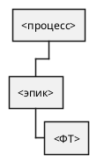

# Документ функциональных требований. Расписание

Вариант: 01 — Расписание.

Команда: Блинов Л.А., Филозоп П.А., Полякова В.В. (группа ПрИн-368).

Источник — эпики EP-1…EP-9 из лабораторной 2.

Схема декомпозиции: [`diagrams/decomposition.puml`](diagrams/decomposition.puml).


Функциональные точки — нескорректированные, учебный подсчёт. Группы данных посчитаны один раз.

| Группа | Тип | Почему низкая сложность | Точки | Кто использует |
|--------|-----|-------------------------|-------|----------------|
| Версия расписания | ILF | одна группа, поля: номер версии, семестр, статус | 7 | ФТ-2.1, ФТ-2.2, ФТ-2.3, ФТ-4.1, ФТ-4.2, ФТ-4.3, ФТ-5.1, ФТ-5.2, ФТ-6.1, ФТ-6.3, ФТ-9.1 |
| Занятие | ILF | одна группа: день, время, период, статус, ссылки на ресурсы | 7 | ФТ-2.1, ФТ-2.2, ФТ-2.3, ФТ-3.1, ФТ-3.2, ФТ-3.3, ФТ-4.1, ФТ-4.3, ФТ-5.1, ФТ-5.2, ФТ-5.3, ФТ-6.1, ФТ-6.2, ФТ-6.3, ФТ-7.1, ФТ-8.1, ФТ-8.2, ФТ-9.1, ФТ-9.2 |
| Журнал изменений | ILF | одна группа: вид, было, стало, время, автор, ссылка на занятие | 7 | ФТ-5.3, ФТ-7.2, ФТ-8.1, ФТ-8.2 |
| Уведомление | ILF | одна группа: получатель, вид, статус отправки, ссылка на журнал | 7 | ФТ-7.2, ФТ-7.3 |
| Сопоставление аккаунта MAX | ILF | одна группа: аккаунт MAX, аккаунт Moodle, ссылка на группу или преподавателя | 7 | ФТ-4.3, ФТ-5.1, ФТ-5.4, ФТ-7.1 |
| Загрузка семестра | ILF | одна группа: семестр, время загрузки, статус (полная или частичная), недоступные системы | 7 | ФТ-1.1 |
| Преподаватель | EIF | читается из корпоративной системы, система его не хранит | 5 | ФТ-1.1, ФТ-2.1, ФТ-3.2, ФТ-5.2, ФТ-9.1, ФТ-9.2 |
| Учебная группа | EIF | читается из корпоративной системы, система её не хранит | 5 | ФТ-1.1, ФТ-2.1, ФТ-3.2, ФТ-5.2 |
| Аудитория | EIF | читается из корпоративной системы, система её не хранит | 5 | ФТ-1.1, ФТ-2.1, ФТ-3.2, ФТ-9.1, ФТ-9.2 |
| Нагрузка по дисциплине | EIF | читается из корпоративной системы, система её не хранит | 5 | ФТ-1.1, ФТ-1.2, ФТ-1.3, ФТ-2.1 |
| Аккаунт Moodle | EIF | читается из Moodle, система его не хранит | 5 | ФТ-5.4 |

Сумма по данным: 67.

## 1. Декомпозиция

| История | Функциональные требования |
|---------|---------------------------|
| US-1 | ФТ-1.1: Система должна… |

## 2. Спецификация функций

### ФТ-1.1

- Формулировка: Система должна…
- История-источник:
- Актор:
- Вход:
- Результат:
- Ошибочный вход:
- Приоритет MoSCoW:
- Обоснование приоритета:

```text
Given:
When:
Then:
```

## 3. Схема декомпозиции

Исходник: `diagrams/decomposition.puml`. Идентификаторы на схеме те же, что в разделе 2.



## 4. Оценки сложности

| ID | Тип (EI, EO, EQ, ILF, EIF) | Сложность и почему | Функциональные точки | Карты покера | Пользовательские поинты | Что раздувает оценку |
|----|----------------------------|--------------------|----------------------|--------------|-------------------------|----------------------|
| ФТ-1.1 | | | | | | |

Сумма функциональных точек:  
Сумма пользовательских поинтов:

Внутренние и внешние группы данных, посчитанные один раз:

| Группа данных | ILF или EIF | Сложность | Точки | Какие функции её используют |
|---------------|-------------|-----------|-------|-----------------------------|
| | | | | |

## 5. Матрица трассировки

Колонка нефункциональных требований заполняется в лабораторной работе 4.

| ID | Тип | Источник | Связанные ФТ | Приоритет | Критерий приёмки | FP | Поинты |
|----|-----|----------|--------------|-----------|------------------|----|--------|
| | Пользовательское | | | | | | |

## 6. Выводы

Какие функции дают основной объём в точках. Какие функции дороги в поинтах при небольшом объёме данных. Что из этого команда берёт в ближайший выпуск.
